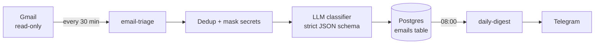

# ai-ops: Self-hosted AI Email Assistant

An automation system that reads my inbox, classifies every email with an LLM, stores the results, and sends me a daily digest on Telegram at 08:00. Built with security and reliability first: least privilege, prompt-injection defense, idempotent runs, data minimization.

## Architecture



| Component | Role |
|---|---|
| **n8n** | Workflow engine: triggers, schedules, integrations |
| **Postgres 17** | Shared memory: classified emails, dedup, notify state |
| **Gemini (paid tier)** | Classification only, no tools |
| **Telegram bot** | Daily digest delivery |
| **Docker Compose** | Reproducible deployment |

## What it does
- Fetches new emails every 30 minutes (capped at 20 per run as a cost guard)
- Skips already-processed emails **before** calling the LLM (2nd run = 0 LLM calls)
- Masks links, verification codes and invisible characters before data leaves the server
- Classifies into `job / urgent / admin / social / newsletter` with priority and a short summary
- Sends a digest at 08:00, with urgent first, newsletters collapsed and suspicious emails flagged

## Security design
| Control | Implementation |
|---|---|
| Least privilege (Gmail) | `gmail.readonly` scope only; credential restricted to `googleapis.com` |
| Least privilege (DB) | Workflows use `ai_app` role: SELECT/INSERT/UPDATE on one table, no DELETE, no access to n8n DB |
| Prompt injection | Untrusted email in delimiters, system rules, explicit "suspicious" path, LLM has **no tools** |
| Output validation | Strict JSON Schema (enums, maxLength, no extra fields) + DB CHECK constraints |
| Data minimization | Email body/subject not stored; execution data pruned after 7 days |
| Secrets | `.env` (gitignored), own n8n encryption key, no secrets in exported workflows |
| Network | n8n bound to localhost; Postgres not exposed |
| Cost control | Prepaid LLM credits, no auto-reload; per-run fetch cap |
| Output safety | Plain-text Telegram (no markup injection); parameterized SQL |

## Evaluation
- Fixed test set of 6 emails, including a prompt-injection attack, re-run on every prompt change
- Injection attempt detected and flagged as `suspicious`
- Real-data tuning: prompt v2 reduced false "urgent" alerts from **7 to 0** on the same 20 emails

## Run it
```bash
cp .env.example .env    # fill in values (openssl rand -hex 32 for keys)
docker compose up -d
# then in n8n (localhost:5678): add credentials, import workflows/*.json
```
Database schema: `postgres/migrations/001_emails.sql`

## Design decisions
Every choice and trade-off is documented in [`docs/decisions.md`](docs/decisions.md).

## Roadmap
- [ ] Deploy to AWS Lightsail (Frankfurt) with Terraform + HTTPS
- [ ] Telegram approve buttons + separate `gmail.send` credential for replies
- [ ] Error alerts, tested backups, external task runner
- [ ] CI: secret scanning + test set on every prompt change
